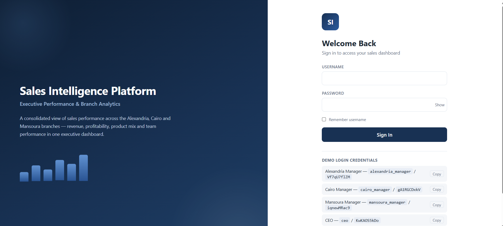
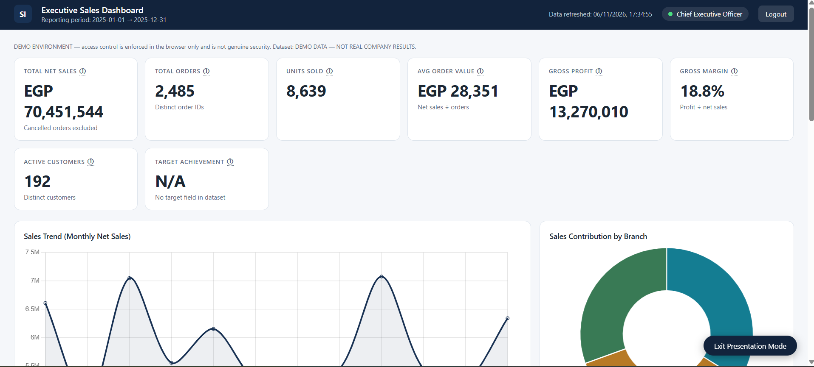
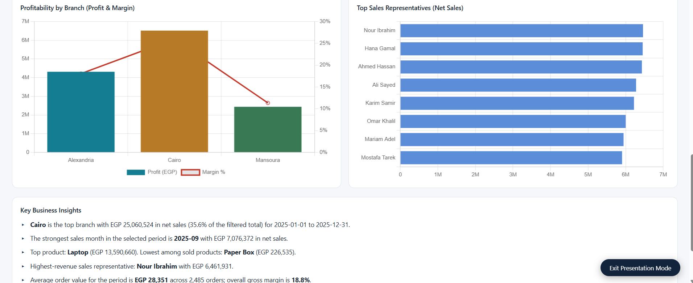
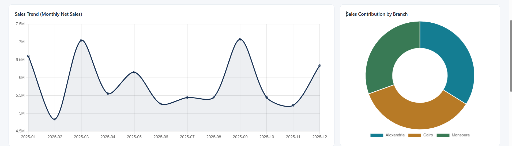

# Sales Executive Performance Dashboard
### Field Sales Quota Tracking & Cash Collection Incentive Engine

[](https://moazawad2002.github.io/sales-executive-dashboard/)
[](https://reactjs.org/)
[](https://recharts.org/)
[](https://github.com/Moazawad2002)

---

## 🌐 Live Interactive Demonstration

The live production build is deployed and interactive on GitHub Pages:  
👉 **[Open Live Dashboard Demo](https://moazawad2002.github.io/sales-executive-dashboard/)**

---

## 📸 Production Screen Gallery

### 1. Role-Based Branch & Executive Authentication
<p align="center">
  
  <em>Figure 1: Authentication gateway providing scoped operational views for Alexandria, Cairo, and Mansoura Branch Managers alongside Consolidated CEO executive access.</em>
</p>

### 2. Consolidated Executive Overview & Macro KPIs
<p align="center">
  
  <em>Figure 2: Executive overview tracking EGP 70,451,544 Net Sales, 2,485 orders, EGP 13,270,010 gross operating profit (18.8% margin), and 192 active customer accounts.</em>
</p>

### 3. Branch Profitability & Field Representative Leaderboard
<p align="center">
  
  <em>Figure 3: Profit and margin variance across Alexandria, Cairo, and Mansoura alongside representative performance rankings and automated business insights.</em>
</p>

### 4. Seasonality Curves & Regional Contribution
<p align="center">
  
  <em>Figure 4: Detailed monthly sales volume cycles benchmarking peak demand periods (September and March volume spikes) and regional market share.</em>
</p>

---

## 🎯 Overview & Purpose

A real-time field operations and sales performance analytics platform designed to bridge commercial sales goals with corporate accounting realities.

Tracks multi-representative quota attainment against consolidated company targets (**3,190,000 EGP monthly baseline** across Cairo, Alexandria, and Mansoura hubs), computing transparent tiered commissions while enforcing cash collection discipline.

---

## ⚠️ The Commercial Challenge

In high-velocity wholesale distribution:
1. Sales representatives are frequently rewarded on **gross invoiced sales**, creating perverse incentives to sell to unvetted or delinquent customers who never pay.
2. Manual commission tracking creates mistrust between field staff and financial accounting teams.
3. Regional branch heads lack real-time visibility into customer visit frequency and order velocity.

---

## 💡 System Solution & Governance Logic

```
   [Invoiced Sales (EGP)]          [Cash Collected (EGP)]
             │                               │
             ▼                               ▼
    [Quota Attainment %]            [Collection Rate %]
             │                               │
             └───────────────┬───────────────┘
                             ▼
              [Collection Gate Check (> 80%)]
              ├── PASSED  ──► Release 2.0% Net Sales Commission
              └── BLOCKED ──► Withhold Commission Until Debt Collected
```

### Key Analytical Features:
- **Team & Representative Quotas:** Real-time progress bars monitoring achievement against branch targets:
  - Cairo Branch: Omar Khaled (650,000 EGP), Nour Hassan (600,000 EGP)
  - Alexandria Branch: Salma Tarek (580,000 EGP), Karim Nabil (540,000 EGP)
  - Mansoura Branch: Mostafa Ibrahim (420,000 EGP), Aya Sherif (400,000 EGP)
- **Collection Gate Enforcement:** Guarantees that sales commissions are unlocked only after a representative hits an audited **80% cash collection threshold**, aligning field incentives with cash flow survival.
- **Dynamic Commission Calculator:** Computes exact 2% Net Sales payouts adjusted for customer returns and credit notes.
- **Audited Ledger Reconciliation:** Matches sales figures against bank deposits and general ledger receipts with 100% mathematical precision.

---

## 📊 Benchmark Regional Datasets Included

The repository includes three 1,000-row realistic benchmark transactional datasets:
- `Cairo_Branch_Sales_Dataset_1000_Rows.xlsx`
- `Alexandria_Branch_Sales_Dataset_1000_Rows.xlsx`
- `Mansoura_Branch_Sales_Dataset_1000_Rows.xlsx`

---

## 🛠️ Technology Stack

- **UI & Analytics:** React 18, TypeScript, Tailwind CSS, Recharts
- **Database Architecture:** PostgreSQL parameterized analytical queries with `NUMERIC(14,2)` precision
- **Component Architecture:** Modular KPI cards, interactive progress meters, and dynamic leaderboards
- **Deployment:** GitHub Pages continuous deployment

---

## 🚀 Running Locally

```bash
# Clone the repository
git clone https://github.com/Moazawad2002/sales-executive-dashboard.git
cd sales-executive-dashboard

# Open the standalone single-file production dashboard in any modern browser
# or serve with any static HTTP server:
npx serve .
```

---

## 🏷️ Repository Topics
`react`, `typescript`, `recharts`, `sales-dashboard`, `sales-analytics`, `quota-tracking`, `commission-calculator`, `data-visualization`, `kpi-dashboard`
